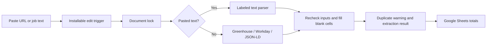

# Automated Internship Tracker

**Paste a job URL. Review the details. Keep every application in one Google Sheet.**

A Google Apps Script project that turns a spreadsheet into an internship application tracker. It retrieves job data from supported public postings, fills empty fields, flags matching URLs, and keeps a running application count alongside imported history.

Built with **JavaScript · Google Apps Script · Google Sheets · HTTP/JSON · JSON-LD**. No API key, paid AI service, or separate server is required.

## Why this exists

Tracking applications should not mean repeatedly copying a company name, job title, description, and link into a spreadsheet. This project keeps the familiar spreadsheet workflow and automates the repetitive entry step. Existing records and manual edits stay in place.

## The workflow

1. Paste a public job posting URL into **G** on an empty tracker row.
2. An installable edit trigger retrieves available posting data.
3. Empty company, position, and description fields are populated. New entries default to **Submitted**, today's date, and an application count of **1**.
4. Read **Autofill result** for missing information, fetch errors, or a possible duplicate.

If a posting is blocked or expired, paste its text into **H**. Include these labels to fill company and position reliably:

```text
Company: Example Robotics
Position: Embedded Software Intern
Develop firmware, test device interfaces, and debug embedded systems.
```

Pasted text takes precedence over the URL. It is parsed locally in Apps Script; this is deterministic extraction, not AI summarization.

## Features

| Capability | Behavior |
| --- | --- |
| URL-based entry | Greenhouse job-board requests, a best-effort Workday adapter, and generic JobPosting JSON-LD extraction |
| Pasted-text fallback | Extracts labeled company/title fields and retains a plain-text description excerpt |
| Preserve manual work | Fills only blank destination cells; rechecks URL/text inputs before writing fetched results |
| Duplicate warnings | Compares normalized links in posting and applicant-portal columns, including common tracking-parameter removal |
| Existing history | Accepts the original six-column layout, with an editable count for grouped applications |
| Running totals | Separately counts tracker rows and applications represented |
| Batch processing | Handles up to 20 edited rows per event; additional selected rows can be processed from a custom menu |
| Concurrent execution | Uses a document lock to serialize script runs |
| Clear failure handling | Reports unreadable postings and missing fields directly in the row |

## Architecture



## Quick start

You need a Google account and an editable Google Sheet. Node.js is only needed for local development tests.

1. Create a **blank Google Sheet**.
2. Open **Extensions → Apps Script**.
3. Replace the default `Code.gs` contents with [`src/Code.gs`](src/Code.gs).
4. Add a script file named `Template` and paste [`src/Template.gs`](src/Template.gs).
5. Save. Select **`createTrackerTemplate`** and click **Run**. This creates the tracker tab; it refuses to overwrite an existing tab with the same name.
6. Select **`setupAutofill`** and click **Run**. Review and authorize the requested permissions.
7. Return to the spreadsheet and reload it. Paste a job URL into **G14**.

No web-app deployment is needed. A simple `onEdit` trigger cannot perform authorized URL fetching, so setup installs an edit trigger. Run setup again to replace this user's existing `autofillOnEdit` triggers with one new trigger.

The default timezone is `America/Regina`. Change the timezone string in `setupAutofill` before running it if needed. The tracker tab name and first data row are defined by `TRACKER` and `FIRST` in `Code.gs`.

### Column reference

The header is on row **13**; records begin on row **14**.

| Column | Field | Purpose |
| --- | --- | --- |
| A | Company | Extracted when available, or entered manually |
| B | Position | Extracted job title |
| C | Date Applied | Defaults to today for new submitted records; editable |
| D | Application Status | Submitted, In Progress, Rejected, Interview, Offer, Withdrawn, or Saved |
| E | Details | Plain-text excerpt, capped at 1,500 characters plus an excerpt notice |
| F | Applicant Portal | Preserved historical portal link; new rows use the posting URL |
| G | Job posting URL | Primary autofill input |
| H | Pasted job text | Optional fallback; takes priority over G |
| I | Autofill result | Extraction feedback and duplicate warning |
| J | Application count | Usually 1; editable for grouped historical entries |

### Bring your existing history

Copy historical **Company, Position, Date Applied, Application Status, Details, Applicant Portal** cells into **A:F**, beginning at row 14 or below the last existing entry. Enter **1** in J for each ordinary row, or the actual number represented by a grouped entry. Keep spreadsheet dates as dates when copying.

The original project retained the six-column layout of an existing application spreadsheet. Personal application records, counts, sheet IDs, and account screenshots are intentionally excluded from this repository.

The total is **applications represented**, not a count of verified unique applications or confirmed submissions. Saved rows, grouped entries, and unresolved duplicates can affect its interpretation. Status summary counts are row counts.

## Development and testing

```bash
git clone https://github.com/sneakyninja1/automated_internship_tracker.git
cd automated_internship_tracker
npm test
```

The test suite uses Node's built-in test runner and synthetic spreadsheet/HTTP fixtures. No npm dependencies or credentials are needed. GitHub Actions runs the same tests on pushes and pull requests.

Tests exercise HTML/entity cleanup, nested JSON-LD, labeled text, Greenhouse and Workday response handling, HTTP failures, duplicate warnings, preservation of manual values, and edits that arrive during a fetch. They do not emulate Google's authorization system or prove that every live job board remains accessible.

For an optional live smoke test, run `verifyAutofill` in Apps Script. It creates a temporary test tab, fetches a public Greenhouse posting, checks text fallback and overwrite protection, and removes the temporary tab in a `finally` block. The live test depends on that posting remaining available. During the initial deployment, live URL entry, duplicate detection, text fallback, and preservation of edits were verified in Google Sheets.

## Permissions and data handling

The `@OnlyCurrentDoc` annotation scopes spreadsheet access to documents where the script is installed. Setup requests permission to manage that spreadsheet, connect to external services, and run the installed trigger without the user present.

- Job URLs are requested from the hosting sites and supported job-board endpoints.
- Pasted text and application rows are processed in the bound Apps Script project. There is no external AI endpoint or analytics service in the code.
- The script does not request Gmail access or use a Drive-wide file API.
- Installable triggers run as the user who creates them. Anyone permitted to edit the sheet can cause that trigger to process input; use it with trusted collaborators.
- Use public job URLs, not links containing private login tokens. Input checks are basic validation, not a general-purpose secure URL proxy.

To disable automation, open **Extensions → Apps Script → Triggers** and delete `autofillOnEdit`. You can revoke the script's permissions from your Google Account's third-party connections settings.

## Limitations and design decisions

- Login-only portals, JavaScript-only pages, anti-bot restrictions, expired postings, and missing structured data can prevent extraction. The Workday endpoint is best-effort and may change.
- Company names are left blank when the source does not provide one. A Greenhouse board display name may differ from the employer's legal name.
- Descriptions are excerpts, not generated summaries. Refer to the original posting for full requirements.
- Duplicate detection is a warning based on normalized URLs, not fuzzy matching across titles or employers. It does not merge or delete records.
- New rows default to Submitted and today even when extraction fails. Change these for saved roles or earlier applications; preset Saved before pasting to leave Date Applied empty.
- Sorting or moving rows while a fetch runs is not supported. The lock serializes script executions, not human spreadsheet edits.
- Apps Script execution and URL-fetch quotas apply. If a batch is skipped or incomplete, retry selected rows from **Internship tracker → Fill selected rows**.
- The original six-column history is imported through spreadsheet paste; there is no OAuth-based importer or automatic synchronization with another workbook.

## Project structure

```text
src/Code.gs                 Autofill workflow and optional live verification
src/Template.gs             Blank tracker initialization
tests/tracker.test.cjs      Offline behavioral tests with synthetic fixtures
.github/workflows/test.yml  Continuous integration
docs/resume.md              Resume bullets and interview talking points
```

## Reference documentation

- [Google Apps Script installable triggers](https://developers.google.com/apps-script/guides/triggers/installable)
- [Apps Script authorization and current-document scopes](https://developers.google.com/apps-script/guides/services/authorization)
- [Greenhouse Job Board API](https://docs.greenhouse.io/job-board.html)
- [Schema.org JobPosting](https://schema.org/JobPosting)

